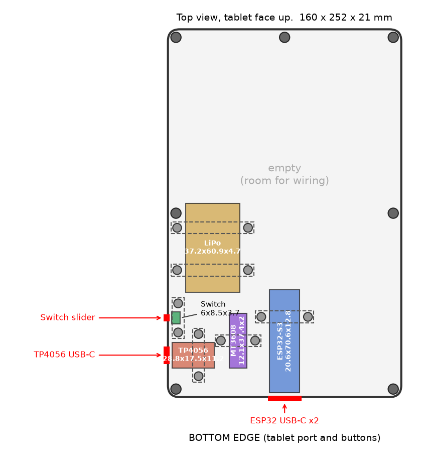

# PaperSync relay case

A tray 160 x 240 mm, 21 mm tall with the lid. The T605 is 160 x 252; the case
is 12 mm shorter so it prints in one piece on a 200 x 250 bed. It lines up with
the tablet's bottom edge.
The lid velcros to the back of the tablet. The tray floor faces the desk.

## Files

| File | What it is |
| --- | --- |
| `case.py` | The model. Every size is a named value at the top. Edit and rerun. |
| `layout.png` | Top view for review, tablet face up, port edge at the bottom. |
| `step/*.step` | The same parts as editable solids. Open these in Fusion (File > Open, or drag in) to change sizes by pushing and pulling faces. |
| `stl/tray.stl`, `stl/lid.stl` | Whole parts for the slicer. Fit a 200 x 250 bed with the long side along the 250. |
| `stl/strap_*.stl` | One strap per board (two for the LiPo). |
| `stl/straps_all.stl` | All six straps laid out on one 57 x 73 mm plate, for print services that limit the number of files. |

Regenerate after editing: `pip install build123d matplotlib`, then
`python3 case.py`. It writes both the STEP and the STL files.

## Layout

- **ESP32-S3**: lower left, both USB-C ports facing the left edge, next to
  the tablet's own port, so the tablet cable stays short. The second port
  stays reachable for reflashing without opening the case.
- **TP4056**: bottom middle, charging port on the bottom edge.
- **Switch**: left edge, above the ESP32 ports. Lies on its side with the
  slider poking out through a 5 x 2.9 mm slot.
- **MT3608**: next to the switch, between the battery and the ESP32.
- **LiPo**: above the boards, held by two straps. Nothing screws through it.

## How parts are held

None of these boards have mounting holes, so each one sits in a 3 mm tall
pocket and a printed strap screws down over it onto two posts. Put a strip of
1 mm foam tape (or double-sided foam tape) on the underside of each strap. It
takes up small measuring errors and stops rattling.

## Hardware

- 7 x M2 x 10 countersunk (flat head) screws (lid). The heads sit flush, so
  nothing presses into the tablet.
- 12 x M2 x 6 pan head self-tapping screws (straps), head no taller than 1.6 mm. The lid has shallow recesses over the ESP32 strap screws so their heads clear.
- 4 x 10 mm stick-on rubber bumpers (recesses under the tray).
- Foam tape, velcro strips (two long strips along the lid edges work well).

## Screw holes

The holes are plain, with no printed thread. M2 threads are too fine to print
well, so the screws cut their own thread into the plastic:

- Pilot holes in posts: 1.8 mm, so an M2 screw bites into the walls.
- Clearance holes in straps and lid: 2.4 mm, so an M2 slides through.
- Every pilot hole stops 0.8 mm above the bottom of the tray.

Printed holes come out about 0.1 to 0.3 mm smaller than drawn, and these sizes
already allow for that. If a screw is too tight, open the hole with a 2 mm
drill bit by hand.

## Print settings

PLA or PETG, 0.2 mm layers, 3 walls, 20 % infill. Print the tray floor down
and the lid lip up. No supports needed. A light colour lets the TP4056
charging LED glow through the case.

## Check before printing

These were guessed from the caliper sizes, so check them against your parts:

1. **ESP32 port height**: the slot runs 2 to 14 mm above the floor. With the
   header pins pointing down, the board sits on its pins.
2. **Switch slider**: the slot is 5 mm long and 2.9 mm tall. File it wider if
   the slider rubs.
3. **Tablet port position**: the ESP32 ports sit 40 to 61 mm up from the
   bottom on the left edge. Move them with `PARTS["ESP32-S3"]["pos"]` and the
   matching entry in `CUTOUTS` if the tablet's port is higher or lower.
